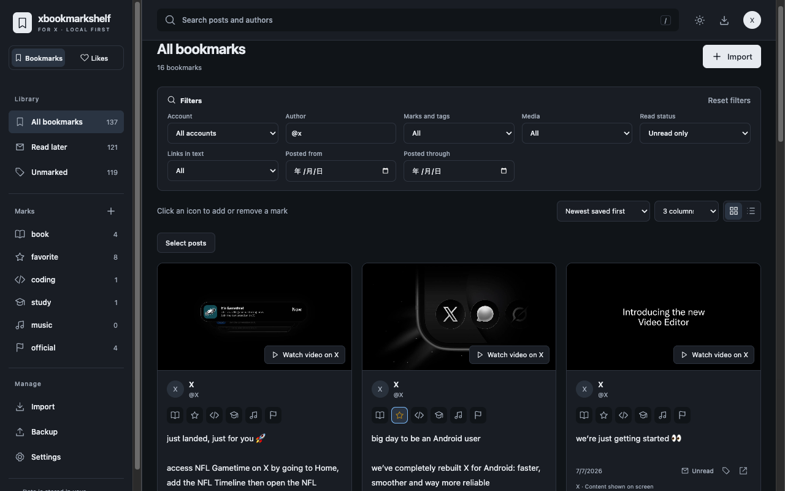

# xbookmarkshelf

English | [日本語](README.ja.md)



A viewer for organizing and reading your X bookmarks and likes. Create marks with your own names and icons to group posts by topic, then search and filter your library. Available as a Chrome extension and a standalone local library app that opens JSON files on your computer.

Version 0.1.1 is designed for Chrome on Windows.

## Install the Chrome extension

The packaged extension requires Chrome 120 or later. You do not need Node.js, npm, or a server to use it.

If you installed the Chrome Web Store version, Chrome handles its updates. For the ZIP distributed through GitHub Releases, use the steps below.

1. Extract the extension ZIP.
2. Open `chrome://extensions` in Chrome and enable Developer mode.
3. Click "Load unpacked" and select the extracted folder containing `manifest.json`.

To update, replace the files in the same folder and reload the extension, X tab, and library. Use the same extension ID and Chrome profile to retain your data.

## Import bookmarks and likes

The extension reads content displayed on X's pages (the DOM). Use it at your own risk.

1. Sign in to X and open Bookmarks or Likes in [History](https://x.com/i/history). The regular bookmarks page and the likes page on your own profile are also supported.
2. Click the extension icon and check the import target, scope, wait mode, and posts per run.
3. Click "Import gradually" and keep the X tab visible.

Posts are saved in batches of up to 10. The default is a fixed three-second wait and 100 posts per run. Choose a fixed wait or a random wait between a minimum and maximum, within 3–30 seconds. The three-second minimum helps reduce load on X. The limit can be set to 10–1,000 posts, and your import settings are remembered.

You can change the bookmarks and likes URLs under "Settings → Import URLs" and restore the defaults with "Reset URLs". Only HTTPS URLs on `x.com` are supported. Normally, no changes are needed. These settings can handle URL changes; changes to X's page structure may still require an extension update.

Importing continues after you close the popup, and repeated imports avoid duplicate posts. It stops if the X tab is hidden, you navigate away, or an access restriction is detected. Complete imports and full synchronization are not guaranteed.

## Browse and organize your library

Click "Open library", then use the switch below the logo to choose Bookmarks or Likes. Posts, marks, and read status are managed separately; display settings are shared.

- Search post text and filter by author, account, mark, read state, media, links in the text, or posting date. In the Author filter, `@handle` matches that handle exactly; text without `@` matches part of a name or handle.
- Create up to 30 marks per account, each with a name and icon. A post can have multiple marks, with up to 20 marks and tags combined.
- Click a mark icon to assign or remove it. Find additional marks under "…" and change their order on the marks page.
- Opening a post marks it as read and removes it from "Read later". "Unmarked" shows posts without a mark.
- Sort by save order or by newest or oldest posting date. Posts with unknown dates appear last when sorting by posting date.
- Use continuous scrolling, card or list view, 1–5 columns, light or dark themes, and Japanese or English. The default language follows your browser's language.

## Auto-mark with LM Studio

This optional feature requires a local LM Studio server with an image-capable decision model such as d1-3B loaded. Basic browsing and manual marks work without it.

1. Under "Auto-mark with local AI" at the bottom of Settings, enter the server URL and model ID (defaults: `http://127.0.0.1:1234` and `d1-3b`) and choose the match threshold. Click "Connect and save" in the extension or "Connect and apply" in the local app. The extension requests access to the local server and, if selected, X images. The local HTML requires **Enable CORS** in LM Studio Server Settings.
2. Create marks with names that describe their categories. The default threshold is 80%; every matching mark is added. No match leaves the post unchanged, and existing marks are retained.
3. In the extension popup, enable "Auto-mark during import" before starting. Your on/off choice is remembered when the popup closes, alongside the other import preferences. Without saved AI connection settings the checkbox is disabled and imports do not send anything to AI; reconnecting restores the remembered choice. Opening the popup never starts an import or classification. The popup and import page show progress, results, and failure messages for that import, with a Stop control while classification is running. They do not show a separate classification or retry button. To classify saved posts manually, open "Auto-mark" below "Unmarked" in the sidebar, check the account scope and post count, then click "Auto-mark this account scope". Importing continues while classification runs separately; closing the popup does not stop classification.
4. In the local app, search and filter your list, then open "Auto-mark" and check the target count before clicking "Auto-mark search results". Matching continues when you change pages, with a running indicator in the sidebar. Click "Save" to write the changes to your library JSON. Closing or reloading the HTML resets the AI connection settings; connect again the next time you open it.

"Use images for matching" allows AI to use images even when display previews are off. It loads up to four saved image references per post, including quoted images or video covers, from X’s image server (`pbs.twimg.com`) and sends temporary JPEG previews to LM Studio. Like.js entries without images use text only. If the browser cannot fetch an image, that post is reported as failed; turn off AI images to retry with text only. Images are not saved in backups.

Classification uses the mark names as category descriptions. Match probabilities can be wrong; choose a threshold that works for your categories. Stop controls retain completed additions. The extension records classification progress and retries pending work after worker suspension. Deleted posts or changes made during inference are skipped. The server URL is limited to HTTP localhost or 127.0.0.1; API tokens and cloud connections are not supported.

Auto-marking stops after three consecutive classification failures. Completed additions remain; check the settings and start again to retry.

## Images, videos, and link cards

Image previews are on by default in the extension. The local library starts with previews off and remembers your choice. When enabled, images load from their saved URLs. In both versions, click a photo to enlarge it and use the arrows to browse multiple images. Videos show a cover image and a link to the original post. The extension also saves link cards and quoted posts displayed on X.

Images load only from `https://pbs.twimg.com`. There is no feature for downloading image or video files. Images may be unavailable offline or when their URLs expire.

## Backups and deletion

Post backups and display settings use separate JSON files.

| File | Contents and location |
| --- | --- |
| Post backup | Posts, read status, marks, tags, and media URLs. Export all posts or one mark from the backup page. |
| Settings file | Language, theme, columns, view, and image previews. Export or import from Settings. |

Post backup filenames use `xbookmarkshelf-bookmarks-…json` for bookmarks and `xbookmarkshelf-likes-…json` for likes. Older files with `posts` in the name can still be imported.

Post backup imports are limited to 20 MiB per file; settings files to 64 KiB. Post backups do not include display settings or import history. Restore bookmarks and likes into their corresponding libraries. Reimporting preserves read status, marks, and tags.

Large backups are split automatically. Save every part and select all parts together when restoring or adding them to the local library.

Delete selected posts from the list, or delete all posts in the current library from Settings. Settings also shows the post count and estimated storage usage. Mark and tag definitions, settings, and your bookmarks and likes on X are retained. Back up your posts before deleting them, and check that every part of a split backup has been saved.

## Use the local library

Open `xbookmarkshelf-local.html` in desktop Chrome. The HTML file is the app; a separate library JSON file stores your posts. No extension or server is required.

1. Start with "Create library" or "Open library JSON".
2. Use "Add import" to select X API v2 JSON, `data/like.js` from an X archive, an extension post backup, or a library JSON. You can select multiple files. Select every part of a split backup together.
3. Search and organize posts as you would in the extension. Click "Save" to write the library JSON after importing or editing.
4. On your next visit, the app can reopen the previous library JSON. If file access needs permission again, click "Open".

For X API v2 JSON, select a list response containing a `data` array, then choose Bookmarks or Likes and the owning account. Select an existing account or add your own X username, separately from the post author's username. Select multiple pages from the same source and account together, review the counts, and confirm the import. Import files from different accounts or sources separately.

No API key or connection to X is needed. Text, authors, posting dates, images, video covers, and quotes use only information present in the JSON. Bookmarks require author usernames: include `author_id` and `includes.users` with `username`. Images require `attachments.media_keys` and `includes.media`. Missing information and further pages are not fetched. Existing marks, tags, read status, and display settings are kept. To enrich posts previously imported from like.js, select "Likes archive".

The local library supports up to 200,000 posts in total and a library JSON of up to 512 MiB. Source API JSON, like.js, and post backups are limited to 20 MiB and 50,000 posts per file, with at most 512 MiB selected per batch. It uses memory while open. The browser remembers only the selected file reference and your image preview preference.

Back up the entire library, Bookmarks or Likes, or one mark. Bookmarks can also be exported as post JSON for the extension. Display settings are included in the library JSON. Sort by file order, reverse order, or posting date.

Author details and images missing from like.js are not fetched automatically. Dates calculated from post IDs are posting dates, not the time you liked a post. Multiple like.js files are merged into one collection.

If saving fails, your unsaved changes remain in the open app. Retry or use "Save as", and avoid editing the same library JSON in multiple windows. Browsers without direct file saving download the JSON instead.

## License

The product code is licensed under the [MIT License](LICENSE), copyright 2026 riosagg. Third-party code and the posts and images you save remain subject to their respective licenses and rights.

Bundled library licenses are listed in [THIRD_PARTY_NOTICES.txt](public/THIRD_PARTY_NOTICES.txt) for the extension and in the local app's license section. Keep the included license notices when redistributing the app.

[Changelog](CHANGELOG.md) · [Security](SECURITY.md) · [Privacy](PRIVACY.md)

<details>
<summary>Build from source</summary>

Requires Node.js 22.12 or later and npm.

```sh
npm ci
npm run build
```

Load the `dist` folder into Chrome for the extension. Open `local-dist/xbookmarkshelf-local.html` for the local library.

</details>
